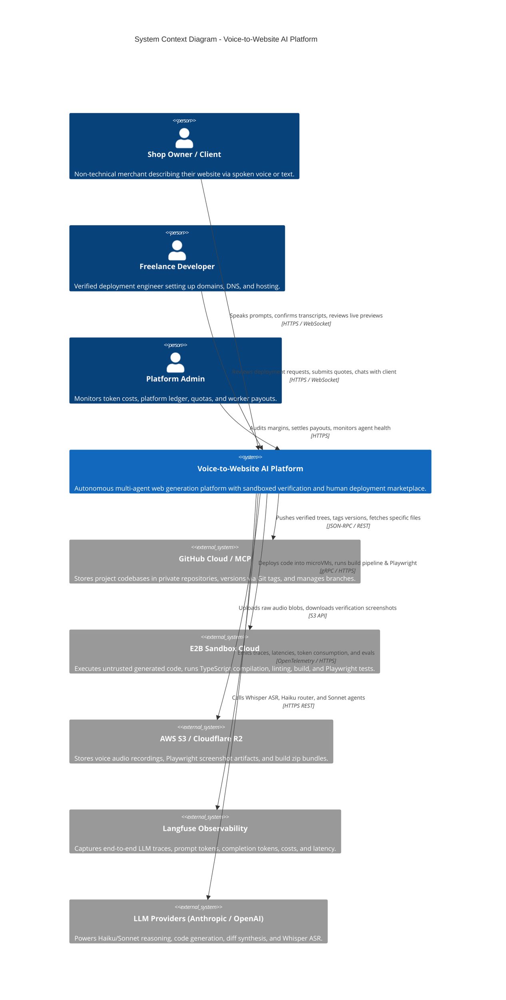
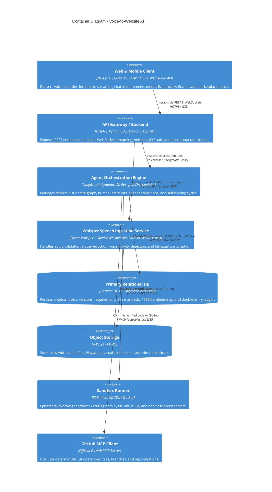
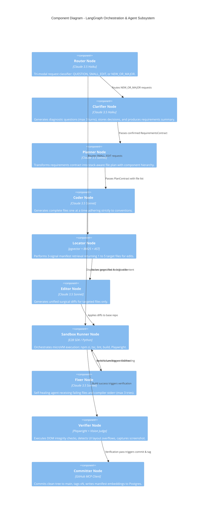
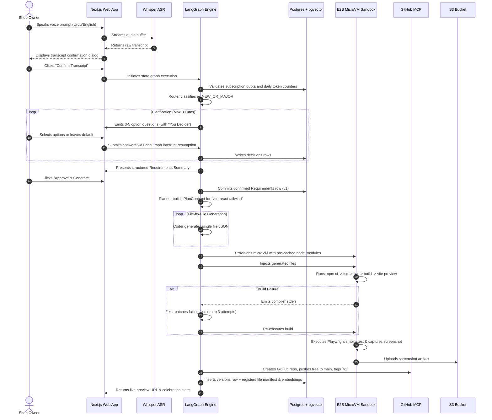
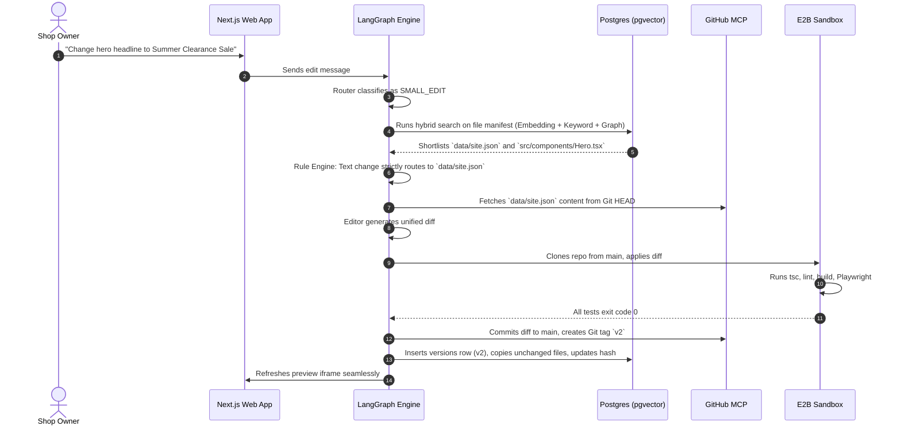

# Architecture Plan (C4 Model & Sequence Specifications)
## Voice-to-Website AI: Enterprise Autonomous Web Generation & Human Deployment Platform

---

### Document Metadata
- **Document Version:** 2.0.0
- **Status:** APPROVED & LOCKED
- **Author:** Principal AI Architect & Staff Systems Architect
- **Related Documents:** [PRD](file:///d:/VoicetoAI/docs/PRD.md), [TDD](file:///d:/VoicetoAI/docs/TDD.md), [Implementation Roadmap](file:///d:/VoicetoAI/docs/IMPLEMENTATION_ROADMAP.md)

---

## 1. C4 Architecture Model

### 1.1 Level 1: System Context Diagram
The System Context diagram illustrates the boundaries of the Voice-to-Website AI system and how users and external systems interact with it.

---

### 1.2 Level 2: Container Diagram
The Container diagram illustrates the high-level technical building blocks of the platform.

---

### 1.3 Level 3: Component Diagram (Agentic Subsystem)
The Component diagram drills into the internal architecture of the LangGraph Orchestrator container.

---

## 2. Comprehensive Sequence Diagrams

### 2.1 Greenfield Project Generation Flow

### 2.2 Surgical Edit & Manifest Retrieval Flow

---

## 3. Threat Model & Security Boundaries (STRIDE Analysis)

| Threat Category | Potential Attack Vector | Architectural Mitigation |
|---|---|---|
| **Spoofing** | Attacker impersonating platform admin or developer in marketplace. | Strict JWT authentication with cryptographically signed role claims; database-backed token invalidation. |
| **Tampering** | Malicious prompt attempting to alter git history or inject backdoors into generated code. | Isolated Committer node using GitHub MCP with scoped tokens; sandbox executes with zero network egress to internal infrastructure. |
| **Repudiation** | Client claiming they never approved requirements or developer disputing payout. | Immutable database audit trail: `decisions` table links user message IDs; double-entry `ledger_entries` cannot be updated or deleted. |
| **Information Disclosure** | LLM-generated code leaking platform environment variables or API keys. | Sandbox microVM runs in complete isolation with zero access to host environment variables or master API keys. |
| **Denial of Service** | Infinite Fixer loop or user submitting massive prompts to exhaust token limits. | Strict per-run ceiling of 300,000 tokens; global timeout of 300s in E2B; rate limiting at FastAPI gateway. |
| **Elevation of Privilege** | Code execution sandbox escape attempting to break out of Docker / microVM. | E2B hypervisor-level isolation (Firecracker microVM); local Docker fallback runs as unprivileged user with read-only root filesystem. |
