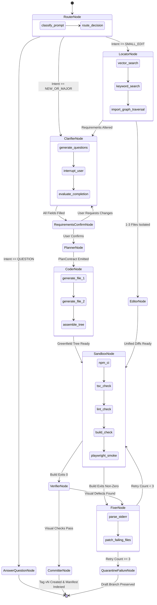

# Feature Specification: Multi-Agent Orchestration & LangGraph Framework
## Deterministic Multi-Agent State Graph, Pydantic Handoffs & Self-Healing Cycles

---

### Feature Metadata
- **Feature ID:** SPEC-002-AGENTS
- **Feature Owners:** Member 1 (Conversation/Router/Clarifier) & Member 2 (Planner/Coder/Fixer)
- **Status:** APPROVED & LOCKED
- **Target Release:** Milestone M1 (Core Engine) & Milestone M2 (Create Flow)

---

## 1. Multi-Agent System Overview

The platform eliminates non-deterministic "agent-to-agent chatter" by employing a strict **Code-Controlled State Machine** built on LangGraph. Autonomous agents act as specialized, bounded processing nodes within the state graph. 

### Core Agent Roster:
1. **Router Agent:** Tri-modal intent classification (`QUESTION`, `SMALL_EDIT`, `NEW_OR_MAJOR`).
2. **Clarifier Agent:** Diagnostic interviewer collecting requirements within 3 turns with explicit options.
3. **Planner Agent:** Architectural planner generating dependency-ordered file trees for `vite-react-tailwind`.
4. **Coder Agent:** Sequential generator writing full file contents strictly one file at a time.
5. **Locator Agent:** 3-signal manifest retriever isolating 1 to 5 files for surgical edits.
6. **Editor Agent:** Precision patch engineer producing unified diffs.
7. **Fixer Agent:** Targeted self-healing engineer repairing compiler & test failures within a 3-retry budget.
8. **Verifier Agent:** Quality assurance engine running Playwright headless audits and vision evaluation.
9. **Committer Node:** Deterministic code-only node calling GitHub MCP to commit verified trees and tag `vN`.

---

## 2. LangGraph State Machine Architecture



---

## 3. Agent Prompts & Operational Specifications

### 3.1 Router Node (Claude 3.5 Haiku)
- **Objective:** Classify user message into exactly one enum with $<300\text{ ms}$ latency.
- **System Prompt:**
```xml
<system_prompt>
You are the Router for Voice-to-Website AI.
Analyze the user prompt and project state. Output a strict JSON object with your classification:
1. "QUESTION": User is asking about their website, how something works, or platform capabilities.
2. "SMALL_EDIT": User wants to modify text, colors, buttons, styles, or add a simple component to an existing site.
3. "NEW_OR_MAJOR": User wants to build a brand new website from scratch or execute an architectural overhaul.

JSON schema:
{
  "intent": "QUESTION" | "SMALL_EDIT" | "NEW_OR_MAJOR",
  "confidence": float (0.0 to 1.0),
  "rationale": "one sentence explanation"
}
</system_prompt>
```

### 3.2 Clarifier Node (Claude 3.5 Haiku)
- **Objective:** Complete missing requirements in $\le 3$ conversational turns.
- **Behavioral Constraints:**
  - Never ask more than 3 to 5 questions in a single turn.
  - Every question MUST provide 3 to 4 clickable options.
  - Option 1 or 4 MUST be `"You Decide (Recommended)"` allowing non-technical users to delegate decisions to AI.
  - When all core fields (business name, primary offerings, color palette, primary CTA, layout structure) are satisfied, emit `all_fields_filled: true` and generate the `RequirementsContract`.

### 3.3 Planner Node (Claude 3.5 Sonnet)
- **Objective:** Generate a complete list of files conforming to `vite-react-tailwind`.
- **Inviolable Rules:**
  - Enforce central data convention: All text, navigation labels, and product details live in `data/site.json`.
  - Enforce clean component modularity: Components in `src/components/` must be single-responsibility (e.g., `Navbar.tsx`, `Hero.tsx`, `ProductGrid.tsx`, `Footer.tsx`).
  - Output strictly conforming to `PlanContract` Pydantic schema.

### 3.4 Coder Node (Claude 3.5 Sonnet)
- **Objective:** Generate syntactically flawless TypeScript / Tailwind code one file at a time.
- **System Prompt Fragment:**
```xml
<guidelines>
- Use Tailwind CSS utility classes exclusively. Avoid inline styles.
- Import data exclusively from `../data/site.json`. Never hardcode copy inside TSX.
- Ensure all lucide-react icons used exist in the official lucide-react package.
- Output ONLY the raw file content enclosed in standard code fences.
</guidelines>
```

### 3.5 Fixer Node (Claude 3.5 Sonnet)
- **Objective:** Targeted healing of compilation and linting errors.
- **Constraints:**
  - The Fixer receives strictly the terminal stderr/stdout stack trace and the exact content of failing files.
  - The Fixer is NOT permitted to rewrite the whole project.
  - Hard retry ceiling: 3 attempts.

---

## 4. Token & Cost Budget Enforcement

1. **Max Token Cap:** Each LangGraph invocation enforces a hard ceiling of 300,000 tokens.
2. **LangGraph Step Limit:** Max recursion limit set to 25 steps per thread.
3. **Database Telemetry Logging:** Every node execution writes to the `runs` table with exact `tokens_in`, `tokens_out`, cost calculation, and `trace_id`.

```python
COST_RATES = {
    "claude-3-5-haiku-20241022": {"input": 0.80 / 1e6, "output": 4.00 / 1e6},
    "claude-3-5-sonnet-20241022": {"input": 3.00 / 1e6, "output": 15.00 / 1e6}
}

def log_agent_run(db_session, version_id: str, agent_name: str, usage, trace_id: str):
    cost = (usage.prompt_tokens * COST_RATES[model]["input"]) + \
           (usage.completion_tokens * COST_RATES[model]["output"])
    db_session.execute(
        insert(RunModel).values(
            version_id=version_id,
            agent=agent_name,
            tokens_in=usage.prompt_tokens,
            tokens_out=usage.completion_tokens,
            cost_usd=cost,
            ok=True,
            trace_id=trace_id
        )
    )
```

---

## 5. Verification & Acceptance Criteria

### Unit Tests
- `test_router_classification_accuracy`: Evaluates 50 benchmark queries, requiring $\ge 96\%$ intent precision.
- `test_clarifier_turn_capping`: Verifies Clarifier transitions to `RequirementsConfirmNode` in $\le 3$ iterations.
- `test_fixer_retry_exhaustion`: Confirms graph routes to `QuarantineFailureNode` after exactly 3 unsuccessful builds.

### End-to-End Tests
- Greenfield generation of full ecommerce site from a single prompt within $<90$ seconds.
- Langfuse trace inspection verifying 100% of LLM spans are tagged with `project_id` and `user_id`.
