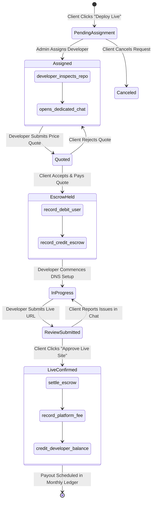

# Feature Specification: Human Deployment Marketplace & Double-Entry Ledger
## Human-in-the-Loop Deployment, Escrow State Machine & Double-Entry Bookkeeping

---

### Feature Metadata
- **Feature ID:** SPEC-006-MARKETPLACE-LEDGER
- **Feature Owner:** Member 4 (Delivery and Business Lead)
- **Status:** APPROVED & LOCKED
- **Target Release:** Milestone M4 (Human Deployment and Money)

---

## 1. Business Problem & Opportunity

AI can reliably generate and verify static code in a sandbox. However, non-technical small business owners (e.g., retail merchants in Lahore or Karachi) cannot navigate DNS A-records, CNAME bindings, custom domain SSL handshakes, and third-party SaaS webhooks. 

Attempting to automate full-stack domain provisioning in an MVP introduces immense regulatory, registrar API, and credit card fraud risks. 

**Voice-to-Website AI** bridges this divide by turning production deployment into a **Human-in-the-Loop (HITL) Marketplace**:
1. The shop owner requests live deployment for their verified version `vN`.
2. An admin assigns a vetted freelance developer.
3. The developer reviews the clean GitHub repo, provides a fixed quote, and chats in a dedicated room.
4. The client pays into an escrow holding account (mock gateway).
5. The developer deploys to production (Vercel/Cloudflare Pages + custom domain) and submits the live URL.
6. The client confirms the live site, releasing funds through a **double-entry ledger** that automatically deducts platform commission (20%) and credits the developer balance (80%).

---

## 2. End-to-End State Machine



---

## 3. Double-Entry Accounting Ledger Specification

Financial records must be completely auditable, tamper-evident, and immune to rounding drift or database desynchronization. The platform enforces strict **Double-Entry Bookkeeping**:
- Every monetary event consists of at least two balanced ledger entries.
- Accounts are classified into:
  1. `user_escrow`: Holds funds deposited by clients awaiting milestone completion.
  2. `escrow_holding`: System escrow clearing account.
  3. `platform_commission`: Platform revenue account (20% fee).
  4. `developer_payable`: Accounts payable liability to developers.

### Mathematical Invariant:
For every transaction reference $T_k$:
$$\sum_{i=1}^M \text{Debit}_i = \sum_{j=1}^N \text{Credit}_j$$

### Scenario Walkthrough: \$50.00 Live Deployment Quote
```sql
-- Step 1: Client deposits payment into escrow
INSERT INTO ledger_entries (payment_id, account_type, entity_id, debit_cents, credit_cents, reference_memo)
VALUES 
  ('pay_123', 'user_escrow', 'user_abc', 5000, 0, 'Deposit for deployment req #123'),
  ('pay_123', 'escrow_holding', 'platform_system', 0, 5000, 'Escrow held for req #123');
-- Total Debits: 5000 | Total Credits: 5000 (BALANCED)

-- Step 2: Client confirms live site; settlement released (20% fee = $10.00, Developer = $40.00)
INSERT INTO ledger_entries (payment_id, account_type, entity_id, debit_cents, credit_cents, reference_memo)
VALUES 
  ('pay_123', 'escrow_holding', 'platform_system', 5000, 0, 'Escrow released for req #123'),
  ('pay_123', 'platform_commission', 'platform_treasury', 0, 1000, '20% platform commission'),
  ('pay_123', 'developer_payable', 'dev_xyz', 0, 4000, '80% net developer payout');
-- Total Debits: 5000 | Total Credits: 5000 (BALANCED)
```

---

## 4. Pakistan Payment Gateway Strategy & Future Work

- **MVP Implementation:** Internal double-entry ledger combined with a Sandbox / Mock Payment Gateway simulating card entry and instant 3D-Secure webhooks. Real developer disbursements are managed via batch monthly statements with manual bank transfers (1Link / IBFT) recorded in `payouts`.
- **Reasoning:** Stripe does not permit Pakistan-registered business merchant accounts. Operating a mock gateway isolates the software FYP from regulatory scrutiny while demonstrating enterprise-grade ledger mathematics.
- **Future Production Gateway:** Seamless plug-in adapter for **Safepay** (licensed State Bank of Pakistan PSO/PSP) supporting Visa, Mastercard, JazzCash, and Raast.

---

## 5. API & WebSocket Specifications

### 5.1 POST `/api/v1/marketplace/requests`
Initiates a new human deployment ticket.
- **Request:** `{"project_id": "...", "version_id": "..."}`
- **Response:** HTTP 201 Created with `request_id`, `status: "pending_assignment"`.

### 5.2 Dedicated Workroom WebSocket: `/ws/v1/workrooms/{room_id}`
Bidirectional WebSocket connecting client and assigned developer:
- Events: `message_sent`, `quote_submitted`, `quote_accepted`, `deployment_marked_live`, `client_approved`.

---

## 6. Acceptance Criteria & Test Suite

### Unit Tests
- `test_ledger_zero_sum_invariant`: Validates that no transaction can be committed if sum of debits does not equal sum of credits.
- `test_platform_commission_calculation`: Confirms exact 20% platform fee calculation with zero rounding leakage on odd-cent quotes.

### Integration Tests
- `test_full_marketplace_lifecycle`: Simulates end-to-end journey from ticket creation to escrow deposit, developer approval, and monthly payout report export.
