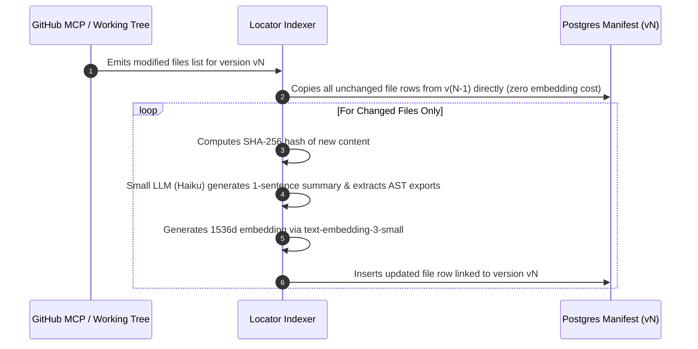

# Feature Specification: Semantic Manifest Search & File Locator (pgvector RAG)
## File-Level Semantic Retrieval, AST Import Graphs & Surgical Edit Localization

---

### Feature Metadata
- **Feature ID:** SPEC-003-RAG-LOCATOR
- **Feature Owner:** Member 3 (Edit and Versioning Lead)
- **Status:** APPROVED & LOCKED
- **Target Release:** Milestone M1 (Schema/Manifest) & Milestone M3 (Production Locator)

---

## 1. Problem Statement: Why Traditional Code RAG Fails

Traditional Retrieval-Augmented Generation (RAG) splits text and source code into arbitrary 300–500 token chunks. When applied to modern component-driven web frameworks (React, Vite, Tailwind), this approach fails catastrophically:
1. **Loss of File Cohesion:** Chunking fragments JSX hierarchies, component prop declarations, and Tailwind layout containers across multiple vector entries.
2. **Poor Semantic Similarity:** Natural language queries (e.g., *"Make the Buy Now button gold"*) have near-zero lexical or semantic overlap with minified CSS classes or raw JSX tags (`<button className="bg-amber-400">`).
3. **Synchronization & State Drift:** Managing separate external vector databases (Pinecone, Qdrant) alongside a relational database creates distributed transaction split-brain errors when code versions are committed or rolled back.

---

## 2. The Solution: File-Level Semantic Manifest with pgvector

Instead of chunking code, the platform maintains a **File Manifest** directly inside PostgreSQL using the `pgvector` extension. 
- **Granularity:** Exactly **one row per file**.
- **Vector Embedding Content:** An embedding of `path + semantic summary + exported symbols` (generated by Claude 3.5 Haiku at version commit time).
- **Relational Integrity:** A version row (`versions`), its file manifest rows (`files`), and their vector embeddings are committed within a **single ACID transaction**.

```
┌────────────────────────────────────────────────────────────────────────┐
│                        FILES MANIFEST TABLE ROW                        │
├────────────────────────────────────────────────────────────────────────┤
│ path:         src/components/ProductCard.tsx                           │
│ role:         component  (enum: component, content, page, style, etc.) │
│ summary:      "Product display card with product image, price tag, and  │
│               interactive Add to Cart action button."                  │
│ exports:      ["ProductCard", "ProductCardProps"]                      │
│ imports:      ["data/site.json", "src/components/Button.tsx"]           │
│ content_hash: "e3b0c44298fc1c149afbf4c8996fb92427ae41e4..."           │
│ embedding:    [0.0124, -0.0452, ..., 0.0891] (1536-dim vector)        │
└────────────────────────────────────────────────────────────────────────┘
```

---

## 3. Three-Signal Hybrid Retrieval Algorithm

When an edit request arrives (e.g., *"Change the Buy Now button to Add to Cart and make it gold"*), the Locator executes a three-phase shortlist synthesis:

```
                          User Modification Request
                                     │
         ┌───────────────────────────┼───────────────────────────┐
         ▼                           ▼                           ▼
┌──────────────────┐       ┌──────────────────┐       ┌──────────────────┐
│ Signal 1: Vector │       │ Signal 2: Lexical│       │ Signal 3: Import │
│ Cosine Search    │       │ Keyword & Path   │       │ Graph Traversal  │
│ (pgvector HNSW)  │       │ ('button','cart')│       │ (Parents/Children│
└────────┬─────────┘       └────────┬─────────┘       └────────┬─────────┘
         │                          │                          │
         └───────────────────► Top Candidates ◄────────────────┘
                                     │
                                     ▼
                      ┌─────────────────────────────┐
                      │ Convention Router:          │
                      │ Text/Labels -> data/site.json│
                      │ Styling/UI  -> ProductCard.tsx│
                      └──────────────┬──────────────┘
                                     │
                                     ▼
                      Final Shortlist (1 to 3 Files)
```

### 3.1 Signal 1: Semantic Vector Search
```sql
SELECT 
    path, 
    role, 
    summary, 
    exports,
    1 - (embedding <=> :prompt_embedding) AS similarity_score
FROM files
WHERE version_id = :current_version_id
ORDER BY similarity_score DESC
LIMIT 5;
```

### 3.2 Signal 2: Lexical Token & Path Matching
Tokenizes the user prompt into n-grams, filters stop words, and matches against `path`, `exports`, and `summary` using PostgreSQL Full-Text Search (`tsvector` / `to_tsquery`).

### 3.3 Signal 3: Import Graph Traversal
Using the `imports` column, the locator inspects modules connected to the top candidates. If `src/components/ProductCard.tsx` is hit, its imported dependencies (`data/site.json`, `src/components/Button.tsx`) are automatically pulled into the evaluation context.

### 3.4 Convention Routing Engine
The Planner and Coder enforce a strict architectural invariant:
- **Rule:** All copy, pricing numbers, headlines, and button labels live in `data/site.json`. Components only render data.
- **Routing Decision:**
  - If the edit is purely textual $\to$ Route strictly to `data/site.json` (role: `content`).
  - If the edit modifies layout, colors, or animations $\to$ Route to the respective TSX component (role: `component`) or `tailwind.config.js` (role: `config`).

---

## 4. Incremental Version Indexing & Deduplication

Generating summaries and vector embeddings for every file on every version would be computationally wasteful. The platform employs **Hash-Based Differential Re-indexing**:



---

## 5. Performance Benchmarks & Evals

- **Retrieval Accuracy Target:** Locator must isolate the exact correct target files in $\ge 90\%$ of 30 benchmark surgical edit tasks.
- **Precision@3:** $\ge 0.92$ (The true file to edit is within the top 3 recommendations).
- **Indexing Overhead:** Re-indexing after an edit must complete in $< 800\text{ ms}$ (since only 1-2 files changed).
- **Query Latency:** Combined 3-signal SQL query execution time $< 65\text{ ms}$ over 200 files.

---

## 6. Test Suite Specifications

### Unit Tests
- `test_pgvector_hnsw_cosine_query`: Validates cosine distance calculation and index utilization.
- `test_convention_routing_text_to_json`: Asserts queries regarding headline/button text route to `data/site.json`.
- `test_unchanged_file_deduplication`: Verifies zero embedding API calls are triggered for unchanged file hashes.

### Integration Tests
- `test_full_locator_pipeline`: Executes 30 real-world edit queries against an ecommerce repo manifest and measures Recall@K.
