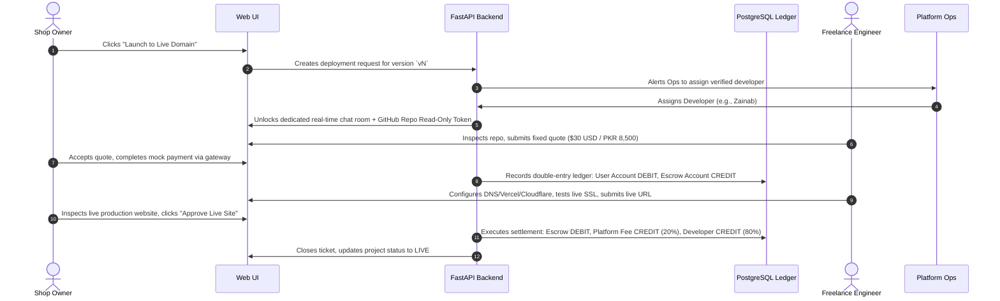

# Product Requirements Document (PRD)
## Voice-to-Website AI: Enterprise Autonomous Web Generation & Human Deployment Platform

---

### Document Metadata
- **Document Version:** 2.0.0
- **Status:** APPROVED & LOCKED
- **Author:** Principal AI Architect & Staff Technical Program Team
- **Target Audience:** Engineering Leads, Full-Stack Engineers, ML/Prompt Engineers, Academic Reviewers & FYP Committee
- **Related Documents:** [Technical Design Document](file:///d:/VoicetoAI/docs/TDD.md), [Architecture Plan](file:///d:/VoicetoAI/docs/ARCHITECTURE.md), [Implementation Roadmap](file:///d:/VoicetoAI/docs/IMPLEMENTATION_ROADMAP.md)

---

## 1. Executive Summary & Vision

### 1.1 Problem Statement
Small-to-medium enterprise (SME) owners, retail shop proprietors, and non-technical entrepreneurs—particularly in multilingual emerging markets such as Pakistan—face an insurmountable digital barrier. Off-the-shelf website builders (e.g., Wix, Shopify, Squarespace) require extensive desktop computer literacy, English fluency, understanding of layout systems, and time commitments they cannot afford. Conversely, hiring bespoke digital agencies is cost-prohibitive, opaque, and involves friction-filled communication cycles.

Existing AI website generators fail in three critical dimensions:
1. **Template Stuffing vs. Real Code:** Most platforms merely inject JSON content into rigid, pre-defined templates rather than generating clean, extensible, component-driven source code.
2. **Context Blindness & Hallucinatory Edits:** Subsequent modification prompts frequently regenerate the whole project from scratch, blowing token limits, breaking preexisting styling, and introducing regressions.
3. **The Deployment Chasm:** A generated static site sitting in an AI tool's proprietary preview sandbox is useless to a merchant who requires a custom domain, SSL, local business integrations, and human reassurance.

### 1.2 Product Vision
**Voice-to-Website AI** is an enterprise-grade autonomous software engineering SaaS platform. A non-technical shop owner describes their dream website in natural spoken voice (Urdu, English, or Roman Urdu) or text. An orchestrated multi-agent system conducts a structured diagnostic interview, extracts verified specifications, plans a bespoke architecture, generates real component-based code (`vite-react-tailwind`), compiles and executes the code inside a hardened, isolated sandbox, and runs automated visual and functional verification checks.

Every verified version is version-controlled via GitHub commits (`v1`, `v2`, ... `vN`). Subsequent modification requests use semantic file-manifest retrieval with pgvector to surgically locate and edit only the affected 1 to 3 files. When the business owner is ready to go live, the platform bridges the digital divide with a **Human-in-the-Loop (HITL) Marketplace**, connecting the client to verified developers via a dedicated escrow-backed workroom with an automated double-entry ledger.

---

## 2. Core Personas

### 2.1 Persona 1: Tariq Khan (The Non-Technical Shop Owner)
- **Background:** Owns a boutique apparel and leather goods store in Lahore. Fluent in Urdu and conversational English. Operates his entire business via WhatsApp and voice notes on a smartphone.
- **Pain Points:** Needs an online presence to share catalog links with overseas customers. Tried WordPress once; was overwhelmed by hosting, cPanel, plugins, and CSS errors. Cannot type long English prompts.
- **Goals:** Speak into his phone in Urdu or English, answer 3 simple clarifying choices, see a live working preview of his store with his actual product categories, and request simple tweaks without breaking anything.
- **Key UX Need:** Voice-first interaction with instant audio playback, Urdu/English speech-to-text transcript confirmation, zero technical jargon, and a clear path to have a human put it live.

### 2.2 Persona 2: Zainab Ahmed (Freelance Deployment Engineer)
- **Background:** Junior-to-midlevel full-stack engineer looking for high-velocity freelance earnings. Experienced in Git, Cloudflare Pages, Vercel, and custom domain setup.
- **Pain Points:** Upwork/Fiverr bidding is saturated and client communication is messy. Clients often bring broken, spaghetti codebase zip files.
- **Goals:** Receive pre-tested, clean GitHub repositories generated by the platform; review automated Playwright visual audit logs; quote a fixed fee for production deployment and domain configuration; earn predictable income via guaranteed escrow payouts.
- **Key UX Need:** Clean workspace ticket view, access to private GitHub repo, in-app messaging room, client milestone sign-off, and transparent payout tracking.

### 2.3 Persona 3: Platform Operations & Super Admin
- **Background:** Platform administrator managing operational margins, AI token consumption, sandbox infrastructure, and marketplace disputes.
- **Goals:** Enforce quota limits on Free/Pro tiers, prevent runaway LLM recursive loops, audit financial transactions across the platform ledger, manage developer payouts, and observe full execution traces in Langfuse.

---

## 3. Product Principles & Inviolable Laws

```
┌────────────────────────────────────────────────────────────────────────┐
│                        THREE INVIOLABLE LAWS                           │
├────────────────────────────────────────────────────────────────────────┤
│ 1. Code Controls the Flow: A deterministic LangGraph state machine     │
│    governs execution routing. LLMs never decide the next state freely. │
├────────────────────────────────────────────────────────────────────────┤
│ 2. Verify with Tools, Not Opinions: A version is NEVER marked complete │
│    until sandbox TypeScript compilation, linting, production build,    │
│    and Playwright smoke tests exit with code 0.                        │
├────────────────────────────────────────────────────────────────────────┤
│ 3. Clarify Before Generating: No code is written until the user        │
│    explicitly confirms a structured requirements summary.              │
└────────────────────────────────────────────────────────────────────────┘
```

---

## 4. User Journeys & End-to-End Workflows

### 4.1 New Project Creation Flow (Greenfield Generation)
```mermaid
sequenceDiagram
    autonumber
    actor User as Shop Owner
    participant Web as Web / Mobile UI
    participant API as FastAPI Gateway
    participant S3 as S3 Audio Bucket
    participant ASR as Whisper ASR Engine
    participant LG as LangGraph Orchestrator
    participant PG as PostgreSQL (State/Checkpointer)
    participant Box as E2B Isolated Sandbox
    participant GH as GitHub MCP / Repo
    participant Ver as Verifier (Playwright)

    User->>Web: Clicks Mic, records spoken prompt in Urdu/English
    Web->>API: Streams audio blob (WAV/WebM)
    API->>S3: Uploads raw audio artifact
    API->>ASR: Executes transcription with bilingual prompt hints
    ASR-->>API: Returns transcript string & confidence score
    API-->>Web: Displays transcript confirmation modal
    User->>Web: Confirms / edits transcript text
    Web->>LG: Dispatches initialization event to LangGraph
    LG->>PG: Validates user plan quota & token caps (300k limit)
    LG->>LG: Router node classifies: [NEW_PROJECT]
    
    rect rgb(240, 248, 255)
    Note over LG,User: Clarification Phase (Max 3 Turns)
    LG->>Web: Clarifier returns 3-5 option-based questions (with "You Decide")
    User->>Web: Submits answers via buttons or voice
    LG->>PG: Commits decisions table rows (topic, choice, reason)
    LG->>Web: Emits structured requirements summary v1
    User->>Web: Clicks "Confirm & Build Site"
    end

    LG->>LG: Planner generates stack-aware file manifest (`vite-react-tailwind`)
    LG->>LG: Coder generates files sequentially (one file at a time)
    LG->>Box: Spins up microVM (2 vCPU, 2GB RAM), mounts pre-cached node_modules
    LG->>Box: Writes files -> runs npm ci, tsc, lint, build, vite preview
    
    alt Sandbox Build Fails
        Box-->>LG: Emits error stdout/stderr
        LG->>LG: Fixer receives only error logs + failing files (Max 3 retries)
        LG->>Box: Patches files and reruns build pipeline
    end

    Box->>Ver: Verifier executes Playwright DOM & layout audit
    Ver-->>LG: Smoke test passes & visual snapshot captured
    LG->>GH: Committer pushes verified tree to main, creates Git tag `v1`
    LG->>PG: Writes file manifest metadata + vector embeddings (path+summary+exports)
    LG->>Web: Streams live preview URL & WebSocket build log completion
    Web-->>User: Displays interactive preview iframe with celebratory UI
```

### 4.2 Incremental Modification Flow (Surgical Edit)
```mermaid
sequenceDiagram
    autonumber
    actor User as Shop Owner
    participant Web as Web / Mobile UI
    participant LG as LangGraph Orchestrator
    participant PG as Postgres (Manifest + pgvector)
    participant GH as GitHub MCP
    participant Ed as Editor Agent
    participant Box as E2B Sandbox

    User->>Web: Speaks: "Change the hero banner text to 50% Grand Opening Sale"
    Web->>LG: Dispatches edit request
    LG->>LG: Router classifies: [SMALL_EDIT]
    LG->>PG: Locator queries file manifest: Vector similarity + BM25 keyword + Import Graph
    PG-->>LG: Shortlists candidates: `data/site.json` (role: content) & `components/Hero.tsx`
    LG->>LG: Convention check: Text edits route directly to `data/site.json`
    LG->>GH: Committer fetches exact content of `data/site.json` ONLY
    LG->>Ed: Editor generates unified diff for targeted file(s)
    LG->>Box: Applies diff in Sandbox; executes tsc, lint, build, Playwright smoke tests
    Box-->>LG: Build & test SUCCESS
    LG->>GH: Commits diff to main, creates Git tag `v2`
    LG->>PG: Updates manifest table, hashes, and version row linked to trigger message
    LG->>Web: Refreshes preview iframe seamlessly
```

### 4.3 Human Deployment & Marketplace Flow


---

## 5. Functional Requirements

### 5.1 Module 1: Multilingual Voice & Chat Ingestion
- **FR-1.1:** Audio Recording: Client Web/PWA shall capture clean microphone audio (Opus/WebM or Linear PCM 16kHz WAV) using the browser `MediaStream Recording API`.
- **FR-1.2:** S3 Archival: All voice clips shall be uploaded to an S3-compatible bucket under `audio/{project_id}/{message_id}.webm` with secure signed URLs.
- **FR-1.3:** Bilingual Whisper ASR: Audio shall be transcribed using OpenAI Whisper (or fine-tuned Whisper large-v3-turbo self-hosted) supporting Urdu, English, and mixed "Urdish" code-switching.
- **FR-1.4:** Mandatory Transcript Confirmation: The UI shall pause execution and present the transcribed text in an editable modal before routing to the AI agent graph.
- **FR-1.5:** Text Chat Fallback: Full accessibility fallback allowing typing prompts directly, bypassing speech ingestion.

### 5.2 Module 2: Intent Classification & Routing
- **FR-2.1:** Tri-Modal Request Routing: Incoming user requests shall be categorized by a high-speed classifier (Haiku-class or regex-assisted zero-shot):
  1. `QUESTION`: Informational queries regarding the existing site, capabilities, or pricing (routes to Q&A retriever).
  2. `SMALL_EDIT`: Specific cosmetic, textual, or component modifications (routes to Locator & Editor).
  3. `NEW_OR_MAJOR`: Project initialization or structural architectural overhauls (routes to Clarifier).
- **FR-2.2:** Ambiguity Handling: If request intent confidence is below 0.82, the Router shall generate a single clarificatory question before delegating to downstream nodes.

### 5.3 Module 3: Clarification & Diagnostic Interview
- **FR-3.1:** Turn Capping: The Clarifier agent shall never exceed 3 interactive turns.
- **FR-3.2:** Structured Questioning: Clarifier must present 3 to 5 multi-choice options per turn, always appending a default `"You Decide (Recommended)"` option.
- **FR-3.3:** Decisions Audit Trail: Any user choice or implicit "You Decide" fallback must be recorded in the `decisions` table with `topic`, `choice`, `reason`, and `message_id`.
- **FR-3.4:** Requirements Summary Confirmation: The Clarifier shall compile a markdown summary of all requirements (brand colors, layout, pages, features, business type) requiring explicit user confirmation before code planning.

### 5.4 Module 4: Stack-Aware Planning & Code Generation
- **FR-4.1:** Pinned Stack Profile: The MVP system shall exclusively generate `vite-react-tailwind` projects using strict TypeScript (strict mode enabled). Future profiles (`static-html`, `nextjs`) shall adhere to the same contract interface.
- **FR-4.2:** Conventional Data Separation: All site copy, navigation links, pricing tables, and hero headlines must reside in `data/site.json`. UI components must read from this central file.
- **FR-4.3:** Sequential Single-File Coder: The Coder agent shall generate files one at a time using structured JSON outputs to prevent context truncation and partial files.

### 5.5 Module 5: Hardened Sandbox Execution & Self-Healing Loop
- **FR-5.1:** Isolated MicroVM / Docker: Build execution must run in an isolated environment (E2B microVM or local Docker container) with 2 vCPU, 2GB RAM, 300-second hard execution timeout, and no filesystem access to the host.
- **FR-5.2:** Outbound Egress Restriction: Sandbox network egress shall be strictly blocked except for the official npm registry (`registry.npmjs.org`) and CDN assets.
- **FR-5.3:** Five-Stage Build Pipeline: Sandbox must sequentially execute:
  1. `npm ci --prefer-offline` (using pre-cached scaffold dependencies)
  2. `npx tsc --noEmit`
  3. `npm run lint`
  4. `npm run build`
  5. `npm run preview -- --port 4173`
- **FR-5.4:** Automated Fixer Healing Loop: If any step exits non-zero, the `Fixer` agent is invoked with strictly the stdout/stderr stack trace and failing file contents. Max retries: 3.
- **FR-5.5:** Quarantine on Exhaustion: If 3 retries fail, the working tree is quarantined on a `draft/failed-vN` branch, main remains untouched, and the user receives a friendly explanation.

### 5.6 Module 6: Manifest-Based Semantic Locator & Surgical Editor
- **FR-6.1:** File Manifest in PostgreSQL: The system shall maintain a `files` table tracking `path`, `role` (`component`, `content`, `page`, `style`, `config`, `api`), `summary`, `exports`, `imports`, and `content_hash`.
- **FR-6.2:** pgvector Semantic Indexing: A 1536-dimensional embedding is generated per file covering `path + summary + exports` (NOT raw JSX/TSX chunks).
- **FR-6.3:** 3-Signal Retrieval Shortlisting: Locator combines:
  1. Cosine similarity search on summaries via pgvector.
  2. Keyword matching on tokens in user prompt against path/exports.
  3. Import graph traversal (expanding parent/child modules).
- **FR-6.4:** Surgical Diff Generation: Editor produces unified diffs targeting only 1 to 3 shortlisted files, ensuring zero regressions in untouched modules.

### 5.7 Module 7: GitHub MCP Versioning & Rollback
- **FR-7.1:** Dedicated GitHub Repository: Every project is backed by a private repository under the platform's GitHub Organization.
- **FR-7.2:** Clean Version Tagging: Every verified sandbox build is committed to `main` by the Committer node via the official GitHub MCP server and tagged as `vN`.
- **FR-7.3:** One-Click Rollback: Users can select any historical version (`v1` to `vN-1`) in the UI; the backend executes a clean checkout/revert commit and resets the active version pointer.

### 5.8 Module 8: Human-in-the-Loop Marketplace & Escrow Ledger
- **FR-8.1:** Deployment Request Ticketing: Users can request live deployment for any verified version.
- **FR-8.2:** Developer Assignment & Scoped Access: System provisions a read-only GitHub access token and opens a dedicated WebSocket chat room.
- **FR-8.3:** In-App Quotation: Assigned developer submits a structured quote containing line items and delivery timeframe.
- **FR-8.4:** Double-Entry Ledger Engine: Every monetary transaction writes immutable rows to `ledger_entries` ensuring:
  $$\sum \text{Debits} = \sum \text{Credits}$$
- **FR-8.5:** Monthly Developer Payouts: Automated accounting report generation summarizing developer balances, gross volume, and platform commission.

---

## 6. Non-Functional Requirements (NFRs)

| ID | Category | Requirement Metric / Standard |
|---|---|---|
| **NFR-1** | **ASR Latency** | Speech-to-text transcription latency $\le 1.8$ seconds for 15-second audio clip. |
| **NFR-2** | **Edit Turnaround** | Incremental surgical edit (Locator $\to$ Editor $\to$ Sandbox $\to$ Git) $\le 30$ seconds. |
| **NFR-3** | **Build Success Rate** | $\ge 85\%$ of greenfield generation tasks build and pass smoke tests within $\le 3$ Fixer attempts. |
| **NFR-4** | **Token Ceiling** | No generation or edit run shall exceed 300,000 cumulative tokens. Average greenfield cost $\le \$2.50$. |
| **NFR-5** | **Security / Sandbox** | Absolute isolation: No environment variables or master secrets exposed to Sandbox VM. Zero host filesystem mount. |
| **NFR-6** | **Availability** | Core API & Preview endpoints maintain 99.9% uptime during operational testing. |
| **NFR-7** | **Observability** | 100% of LLM completions, prompt tokens, completion tokens, latency, and costs logged to Langfuse and PostgreSQL `runs` table. |

---

## 7. Acceptance Criteria for Final Year Project (FYP)

1. **Autonomous Greenfield Delivery:** Given an unscripted bilingual voice prompt, the system clarifies requirements in $\le 3$ turns and generates a fully interactive, mobile-responsive Vite React website with zero human intervention.
2. **Surgical Multi-File Edit:** Given a modification prompt, the system updates only the designated component or data file, compiles successfully, tags `v2`, and displays diff logs.
3. **Robust Rollback:** Ability to instantly roll back to `v1` via GitHub tag checkout and re-render the preview.
4. **End-to-End Marketplace Flow:** Demonstration of user deployment request, admin dispatch, developer quotation, mock escrow payment, live deployment confirmation, and verified double-entry ledger balance.
5. **Rigorous Evaluation Suite:** Benchmark reports on 30 build scenarios, 30 surgical edit tasks, and 30 bilingual Urdu/English audio clips.

---

## 8. Out of Scope (Explicit Cut Lines)

- Full-stack database/backend generation for the generated sites (e.g., generated Postgres/Prisma schemas inside user sites are future work).
- Automatic DNS registrar purchases and automated SSL certificate binding (handled by human deployment engineer in MVP).
- Real financial banking integrations with Stripe/Safepay (mock gateway with double-entry ledger is used to avoid regulatory exposure).
- Multi-framework arbitrary profile switching within the same project (projects are pinned to `vite-react-tailwind`).
